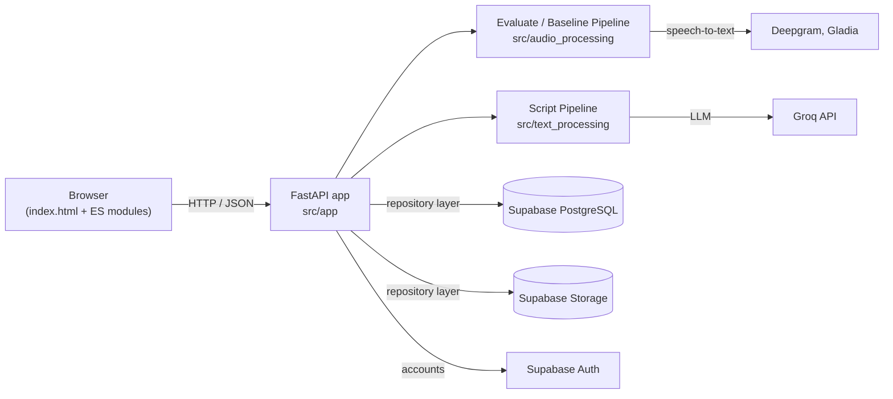
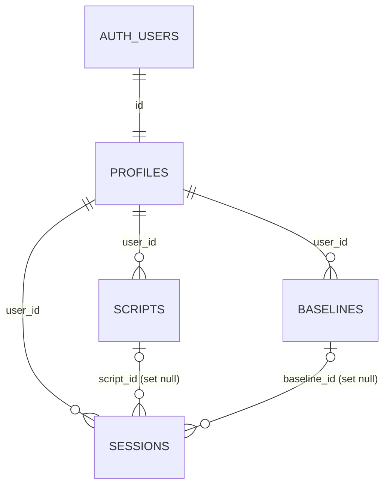
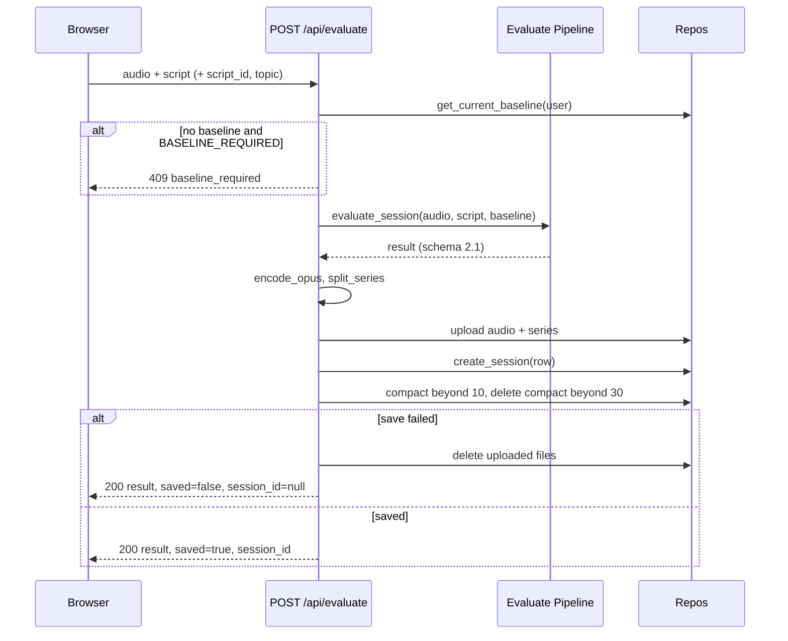

# Architecture

Current structure of Public Speaking Coach: parts, responsibilities, data and the reason for each design choice. Decisions with alternatives are in [`docs/adr/`](docs/adr/).

## Contents

1. [System overview](#1-system-overview)
2. [Code map](#2-code-map)
3. [Backend application](#3-backend-application)
4. [Database and storage](#4-database-and-storage)
5. [Main flows](#5-main-flows)
6. [Browser state](#6-browser-state)
7. [Security](#7-security)
8. [Configuration](#8-configuration)
9. [Testing](#9-testing)
10. [Decision records](#10-decision-records)

## 1. System overview



| Part                         | Technology                       | Responsibility                                          |
| ---------------------------- | -------------------------------- | ------------------------------------------------------- |
| Frontend                     | HTML, CSS, ES modules (no build) | UI served by FastAPI from `src/web/`                    |
| Backend                      | Python 3.12, FastAPI             | HTTP API, validation, orchestration                     |
| Evaluate / Baseline Pipeline | FFmpeg, Silero VAD, jiwer        | Score a recording, analyse a voice baseline             |
| Script Pipeline              | PyMuPDF4LLM, Groq                | Generate an MC script from user content                 |
| Database                     | Supabase PostgreSQL              | Profiles, preferences, baselines, scripts, sessions     |
| Object storage               | Supabase Storage                 | Recordings, chart series, avatars                       |
| Accounts                     | Supabase Auth                    | Sign up, log in, token refresh, password change         |

## 2. Code map

```
db/migrations/              SQL migrations, applied in file order (see 4.5)
src/app/
├── main.py                 FastAPI app: /api/config, /api/evaluate, /api/scripts*, /api/sessions*,
│                           /api/generate-script*, /api/topics, static UI (Cache-Control: no-cache)
├── routes/                 auth.py (/api/auth/*), profile.py (/api/profile*), baselines.py (/api/baseline*)
├── auth.py                 AuthProvider: Supabase Auth, or in-memory accounts in dev
├── deps.py                 get_current_user: user from the Bearer access token
├── config.py               Settings from .env; limits from app_constants.toml; start-up checks
├── constants.py            Loads app_constants.toml
├── key_pool.py             Several API keys per service with automatic switching
└── db/
    ├── models.py           Pydantic models, UserPreferences, errors, object paths, cursor encoding
    ├── repositories.py     Repository interfaces (typing.Protocol)
    ├── supabase_repo.py    Supabase implementation
    ├── memory.py           In-memory implementation (tests, local dev)
    ├── factory.py          Repos container; get_repos() picks the implementation
    └── session_helpers.py  Opus encoding, series split/merge, compaction
src/audio_processing/       Evaluate and Baseline Pipeline
src/text_processing/        Script Pipeline
src/web/
├── templates/index.html    Markup only; loads CSS and static/js/main.js
├── static/css/             base, layout, components, screens (in this order)
└── static/js/              ES modules, no bundler
    ├── main.js             Start-up, event binding, loadConfig() (GET /api/config -> CONFIG)
    ├── state.js            S (app state), CONFIG (defaults for every [web] key), RENDER
    ├── api.js              fetch wrapper: Bearer token, refresh after 401
    ├── evaluate_client.js  Result mapping and follow-along maths; classic script, also run by node tests
    ├── line_numbers.js     Line numbers beside script text
    ├── screens/            home, practice, report, history, profile, landing, script_studio,
    │                       saved_scripts, script_reader
    └── modals/             auth_panel, baseline_gate, settings_modal, profile_modal, confirm
tests/                      pytest (tests/db: repositories and helpers); tests/web: node tests
```

## 3. Backend application

- Endpoints get the caller with `Depends(get_current_user)` and storage with `Depends(get_repos)`; they never import `supabase` directly. Reason: one place for identity and one swap point between Supabase and memory.
- Repository and storage calls are synchronous; async endpoints run them through `run_in_threadpool`, so network I/O and Pillow work never block the event loop.
- `user_id` comes only from `get_current_user`, never from the request body or query.
- Start-up stops when required settings are missing or `max_list_page_size < max_saved_scripts` (one list call must return every saved script).

### 3.1 Endpoints backed by the database

| Method and path                    | Purpose                                                                      |
| ---------------------------------- | ---------------------------------------------------------------------------- |
| `POST /api/baseline`               | Analyse a voice sample; on `ok`, store it as the current baseline            |
| `GET /api/baseline`                | Current baseline, or `null`                                                  |
| `GET /api/baseline/audio`          | Signed URL of the current baseline recording                                 |
| `POST /api/evaluate`               | Score a recording against the stored baseline, then save the session         |
| `GET /api/sessions?limit=&cursor=` | Page of session summaries, newest first, with `next_cursor`                  |
| `GET /api/sessions/{id}`           | One session: full result and signed audio URL, or compact summary            |
| `DELETE /api/sessions/{id}`        | Delete the session files, then the row                                       |
| `POST /api/scripts`                | Save a script; duplicate title/body returns 409; cap returns 409             |
| `GET /api/scripts?limit=&cursor=`  | Saved-script summaries with `total`, cap `limit`, `next_cursor`              |
| `GET /api/scripts/{id}`            | One saved script with its body                                               |
| `PATCH /api/scripts/{id}`          | Edit `title` and/or `body`; duplicate title/body returns 409                 |
| `DELETE /api/scripts/{id}`         | Delete a saved script; linked sessions keep `script_snapshot`               |
| `GET /api/profile`                 | Profile row, `email`, `preferences`, signed `avatar_url` or `null`           |
| `PATCH /api/profile`               | Edit profile fields; `preferences` keys are merged, not replaced             |
| `PUT /api/profile/avatar`          | Multipart `file`; checked by content, resized to a square WebP, stored       |
| `DELETE /api/profile/avatar`       | Delete the avatar file, set `avatar_path` to `null`                          |

`GET /api/config` returns the `[web]` section plus limits shared with the backend (`max_saved_scripts`, `script_title_max_chars`, `max_pdf_size_bytes`, `max_pdf_pages`), so each number is declared once.

### 3.2 Profile preferences

`profiles.preferences` (jsonb) holds per-user UI settings. `UserPreferences` (`db/models.py`) rejects unknown keys and checks ranges against `app_constants.toml`.

| Key                                              | Type | Rule                                                   | Used by                          |
| ------------------------------------------------ | ---- | ------------------------------------------------------ | -------------------------------- |
| `follow_wpm`                                     | int  | `follow_wpm_min..follow_wpm_max`, multiple of the step | Practice follow-along speed      |
| `follow_wpm_min_choose`, `follow_wpm_max_choose` | int  | Same range and step; sent together; min < max          | Slider range (Settings)          |
| `follow_auto_speed`                              | bool | Strict boolean                                         | Auto speed on sentence taps      |

Merging uses the SQL function `merge_profile_preferences` (one `update ... set preferences = preferences || patch`), so two saves close together never drop each other's keys.

### 3.3 Error bodies

| Status | Body                                                                     | When                                               |
| ------ | ------------------------------------------------------------------------ | -------------------------------------------------- |
| 401    | `{"detail": "not_authenticated"}`                                        | No valid current user                              |
| 400    | `{"error": "invalid_cursor"}`                                            | Malformed cursor                                   |
| 404    | `{"error": "session_not_found"}`                                         | Unknown session or another user's session          |
| 409    | `{"error_code": "baseline_required", ...}`                               | Evaluate without a baseline                        |
| 409    | `{"error_code": "script_limit_reached", "limit": N, "count": N, ...}`    | New saved script at the per-user cap               |
| 409    | `{"error_code": "script_duplicate_body" \| "script_duplicate_title", "duplicate_id", "duplicate_title"}` | Duplicate saved script text or title |
| 413    | `{"error_code": "avatar_too_large", ...}`                                | Avatar above `storage.avatar_max_bytes`            |
| 422    | `{"error_code": "avatar_invalid", ...}`                                  | Not PNG/JPEG/WebP, or a side above `avatar_max_side_px` |
| 422    | Validation error                                                         | Bad `preferences` value                            |
| 503    | `{"error_code": "baseline_not_saved" \| "baseline_unavailable", ...}`   | Baseline could not be saved / loaded               |
| 503    | `{"error": "session_storage_unavailable"}`                               | Database or storage error in session endpoints     |
| 503    | `{"error_code": "profile_unavailable", ...}`                             | Database or storage error in profile endpoints     |

## 4. Database and storage

### 4.1 Repository layer

```mermaid
flowchart TB
    Routes["Endpoints"] -->|Depends(get_repos)| Repos["Repos<br/>profiles · baselines · scripts · sessions · files"]
    Repos -.implements.-> Proto["Protocols<br/>repositories.py"]
    Factory["get_repos()"] -->|SUPABASE_URL set| Supa["Supabase*Repo<br/>SupabaseAudioStore"]
    Factory -->|no URL, APP_ENV=dev| Mem["Memory*Repo<br/>MemoryAudioStore"]
    Factory -->|otherwise| Err["StorageError"]
```

| Rule                                   | Reason                                                                 |
| -------------------------------------- | ---------------------------------------------------------------------- |
| Interfaces `ProfileRepo`, `BaselineRepo`, `ScriptRepo`, `SessionRepo`, `AudioStore`; every method takes `user_id` first | Ownership is part of every call |
| Supabase and memory versions behave the same | Unit tests and local runs need no project; production never falls back to memory |
| Missing row and another user's row both return `None` / `False` | No way to probe other users' ids |
| Lists newest first by `(created_at, id)`, cursor based | Stable pages while rows are added |
| List limit `1..storage.max_list_page_size` | Bounded queries; one call returns all saved scripts |
| Library errors become `StorageError` (`ConflictError` for duplicates) | Endpoints map one error type to 503 |
| Object paths only from `build_object_path` (`{user_id}/{id}.webm`, `.series.json`) and `build_avatar_path` (`{user_id}/avatar.webp`) | Every file sits in its owner's folder; other paths are rejected |

### 4.2 Data model

Four tables, all with row level security. Rationale in [ADR-001](docs/adr/ADR-001.md).



| Table       | Holds                     | Rules                                                                                     |
| ----------- | ------------------------- | ----------------------------------------------------------------------------------------- |
| `profiles`  | One row per user          | `id` = `auth.users.id`; delete cascades to all child rows; `avatar_path`; `preferences` jsonb |
| `baselines` | Voice baseline measures   | One `is_current` row per user (unique partial index)                                      |
| `scripts`   | Saved scripts             | Cap `storage.max_saved_scripts` per user; `content_hash` finds duplicates; `source`: `generated_template`, `generated_llm`, `written` |
| `sessions`  | Practice results          | Score columns, `result` JSON, `script_snapshot`; `is_compact`, `mistakes` for old sessions |

### 4.3 SQL functions

| Function                    | Migration | Effect                                                                  | Reason                                       |
| --------------------------- | --------- | ----------------------------------------------------------------------- | -------------------------------------------- |
| `merge_profile_preferences` | `0003`    | Merges a jsonb patch into `profiles.preferences`, returns the row       | Atomic per-key merge                         |
| `replace_current_baseline`  | `0004`    | Locks the current baseline, switches it off, inserts the new one, returns both | One transaction: a failed insert leaves the old baseline current |

Both are `execute` for `service_role` only (revoked from `public`, `anon`, `authenticated`) and take `user_id` as a parameter, because the service key bypasses RLS.

### 4.4 Object storage

| Bucket      | Content                                | Path                                           |
| ----------- | -------------------------------------- | ---------------------------------------------- |
| `audio`     | Practice recording (Opus/WebM, 32 kbps) | `{user_id}/{session_id}.webm`                 |
| `series`    | Pitch and loudness series from `result` | `{user_id}/{session_id}.series.json`          |
| `baselines` | Baseline recording                     | `{user_id}/{baseline_id}.webm`                 |
| `avatars`   | Profile picture, square WebP           | `{user_id}/avatar.webp` (one file, upsert)     |

All buckets are private. Files reach the browser only as signed URLs valid for `SIGNED_URL_TTL_S` seconds. The fixed avatar path means a new upload replaces the old file and nothing needs cleaning up.

### 4.5 Migrations

Run by hand in the Supabase SQL Editor, in file order. Each file starts with `Run:` (`once` or `any time`), `Applied:` (database and date) and `Effect:` lines.

| File                                   | Run      | Creates                                                              |
| -------------------------------------- | -------- | -------------------------------------------------------------------- |
| `0001_init.sql`                        | once     | Tables, indexes, RLS policies, grants                                |
| `0002_storage.sql`                     | once     | Buckets `audio`, `series`, `baselines` and folder policies           |
| `0003_profile_avatar_preferences.sql`  | any time | `profiles.avatar_path`, `profiles.preferences`, bucket `avatars`, `merge_profile_preferences` |
| `0004_replace_baseline_fn.sql`         | any time | `replace_current_baseline`                                           |

Merged migrations are never edited; a schema change is a new file. The backend is deployed only after its migrations have run.

### 4.6 Retention

| Step | Rule | Reason |
| ---- | ---- | ------ |
| Compact | After each saved session, full sessions beyond the newest `retention_full_sessions` (10) lose audio and series files; the row keeps score columns, a summary `result`, `script_snapshot`, `mistakes` | Free-plan storage; history and progress need only the summary |
| Delete | Compact sessions beyond the newest `max_compact_sessions` (30) are deleted | Bounded rows per user: at most 10 full + 30 compact |
| Retry | If file deletion fails the row stays full; the next save retries | No row points to a missing file |

| Measured size (5-minute recording) | Bytes     |
| ---------------------------------- | --------- |
| Full `result` (300 s)              | 1,353,556 |
| Compact `result`                   | 1,356     |
| Compact `mistakes`                 | 74,320    |
| Whole compact row                  | 742,714   |

## 5. Main flows

### 5.1 Save a practice session



- A save error never hides the score ([ADR-002](docs/adr/ADR-002.md)); a compaction error does not change `saved`.
- `insufficient_audio` results are saved without audio.
- The Evaluating Overlay shows the job progress. The shown percent counts up one step every `EVAL_COUNT_STEP_MS` (30 ms) toward the real progress, and the progress bars follow the shown number.
- After `evaluate_background_after_ms` (5 s) the job continues in the background: the overlay closes, the user is sent Home with a notice, and the **Eval Dock** (top right, under the header) shows the bar and percent. Clicking it widens the card to the left and lists the steps, with a Cancel button. Practice and every new recording (Practice, Profile baseline, Word Coach) are locked until the job ends (`practiceLocked()`).
- When the job is done, a dialog offers the report; the dock stays at 100% for `EVAL_DOCK_HOLD_MS` (3 s), then slides out to the right and is hidden. A page reload loses the dialog; the saved session still appears in History.

### 5.2 Baseline

1. `POST /api/baseline` analyses the sample; only an `ok` result is stored.
2. The audio is encoded to Opus and uploaded to `baselines`.
3. `replace_current_baseline` (SQL function, RPC) swaps the current row in one transaction.
4. The old baseline audio is deleted; a failure only logs a warning.
5. `POST /api/evaluate` reads the baseline from the database; a client-sent baseline is ignored.

### 5.3 History

- `GET /api/sessions/{id}` merges the series back into `result` and adds `audio_url` for full sessions. `media_available` is `false` for compact sessions or unreadable files; the Report then hides charts that need the series (for example voice loudness).
- `DELETE /api/sessions/{id}` deletes files first, row second, so a failed file delete never leaves orphan files.

### 5.4 Saved scripts

- A script reaches the `scripts` table only through Save. Practice sends the text without saving; an unsaved script survives only as `sessions.script_snapshot`.
- Duplicate body or case-insensitive title returns `409 script_duplicate_body` or `script_duplicate_title`; a new script at the cap returns `409 script_limit_reached`.
- Deleting a script sets linked `sessions.script_id` to null and keeps `script_snapshot`, so reports still open.

### 5.5 Log in

One loading screen covers the password check and all first data: profile, history with the latest full scores, baseline, saved-script list, web fonts. Home is drawn once after all of them, so nothing on it changes after it appears.

## 6. Browser state

| Store            | Key                       | Content                                             | Cleared                                  |
| ---------------- | ------------------------- | --------------------------------------------------- | ---------------------------------------- |
| `localStorage`   | `psa.auth`                | Access and refresh tokens (F5 keeps the login)      | Log out, session end                      |
| `localStorage`   | `psa.chat.<user_id>`      | Latest Script Studio chat (data, not HTML), newest `chat_history_max_messages` | Log out, account deletion |
| `localStorage`   | `psc.followWpm.<user_id>` | Follow-along speed not yet saved to the profile     | After a successful save                   |
| Profile (server) | `preferences`             | Speed, slider range, auto speed (see 3.2)           | Account deletion                          |

Per-user keys keep two accounts on one browser apart. Every `localStorage` access is wrapped in `try/catch`, so blocked storage only loses the convenience.

## 7. Security

| Layer       | Mechanism                                                                                                   |
| ----------- | ----------------------------------------------------------------------------------------------------------- |
| Identity    | `get_current_user` verifies the `Authorization: Bearer` token (Supabase Auth, or memory accounts in dev); 401 `not_authenticated`. |
| Application | The service key bypasses RLS, so every query and SQL function filters by `user_id` in code. Other users' rows return 404. |
| Database    | RLS on all four tables with owner-only policies (`auth.uid()`); tables granted to `authenticated` and `service_role`, not `anon`; SQL functions executable by `service_role` only. |
| Storage     | Private buckets; policies limit each user to the folder `{user_id}/`.                                       |
| Uploads     | Avatars checked by content (Pillow), size and pixel limits, re-encoded to WebP; audio size capped before reading. |
| Secrets     | Keys only in `.env` (git-ignored); `.env.example` lists names without values.                                |

## 8. Configuration

`.env` holds secrets and per-environment values, read by `src/app/config.py`. `app_constants.toml` holds every tunable number, one comment each; `.env` wins for the keys marked `(.env)` there. The `[web]` section goes to the browser through `GET /api/config`; `main.js:loadConfig()` copies it into `CONFIG`, and `state.js` holds the fallback for each key.

API keys: `DEEPGRAM_API_KEYS`, `GLADIA_API_KEYS`, `GROQ_API_KEYS`, each one or more comma-separated keys. `key_pool.py` locks a key for `exhausted_cooldown_s` on HTTP 429/402 and until restart on 401/403, then tries the next key or provider. Logs show only the key position.

| Setting                                                              | Default                                   | Meaning                                  |
| -------------------------------------------------------------------- | ----------------------------------------- | ---------------------------------------- |
| `APP_ENV`                                                            | `dev`                                     | `dev` allows in-memory repos and accounts |
| `SUPABASE_URL`, `SUPABASE_SERVICE_KEY`                               | empty                                     | Use Supabase when the URL is set         |
| `AUDIO_BUCKET`, `SERIES_BUCKET`, `BASELINES_BUCKET`, `AVATARS_BUCKET` | `audio`, `series`, `baselines`, `avatars` | Bucket names                             |
| `RETENTION_FULL_SESSIONS`                                            | `10`                                      | Full sessions kept per user              |
| `MAX_COMPACT_SESSIONS`                                               | `30`                                      | Compact sessions kept per user           |
| `SIGNED_URL_TTL_S`                                                   | `600`                                     | Signed URL lifetime, seconds             |
| `BASELINE_REQUIRED`                                                  | `true`                                    | Reject evaluation without a baseline     |
| `DEV_USER_ID`, `DEV2_USER_ID`                                        | empty                                     | Test users, read only by integration tests |

Storage limits in `app_constants.toml` `[storage]`: `max_saved_scripts` (10), `script_title_max_chars` (70), `max_list_page_size` (50), `avatar_max_bytes` (2 MB), `avatar_size_px` (256), `avatar_max_side_px` (4096), `max_upload_bytes` (100 MB).

## 9. Testing

| Command                          | Covers                                                                            |
| -------------------------------- | --------------------------------------------------------------------------------- |
| `uv run pytest`                  | Unit tests with `build_memory_repos()` and dependency overrides; no network or keys |
| `uv run pytest -m integration`   | Real Supabase tests on `psc-dev` (repositories, SQL functions, buckets)            |
| `node --test tests/web/evaluate_client.test.js` | `evaluate_client.js`: result mapping, follow-along schedule, auto speed            |
| `uv run ruff check .`            | Lint and import order                                                             |

## 10. Decision records

| ADR                            | Title                                                             |
| ------------------------------ | ----------------------------------------------------------------- |
| [ADR-001](docs/adr/ADR-001.md) | Data model for profiles, baselines, scripts and practice sessions |
| [ADR-002](docs/adr/ADR-002.md) | Report save status in the `/api/evaluate` response (schema 2.1)   |
| [ADR-006](docs/adr/ADR-006.md) | Moderation layer 2 (Llama Guard via Ollama)                       |

## Accounts

| Part                        | Role                                                                                                     |
| --------------------------- | -------------------------------------------------------------------------------------------------------- |
| `src/app/auth.py`           | `SupabaseAuthProvider` (service key, server side) and `MemoryAuthProvider` (dev, tests); `get_auth()` picks one like `get_repos()` |
| `src/app/routes/auth.py`    | `POST /api/auth/signup` creates the account and its `profiles` row (account removed if the profile fails); `/login`, `/refresh`, `/logout`; `PUT /api/auth/password` |
| `src/app/routes/profile.py` | Profile, consent, `preferences`, avatar                                                                  |
| `src/app/deps.py`           | Verifies the Bearer token; 503 `auth_unavailable` when Supabase Auth is unreachable                      |
