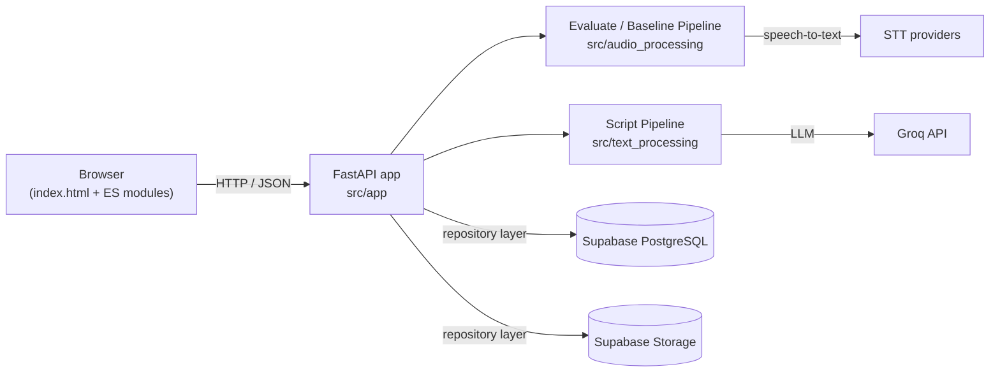
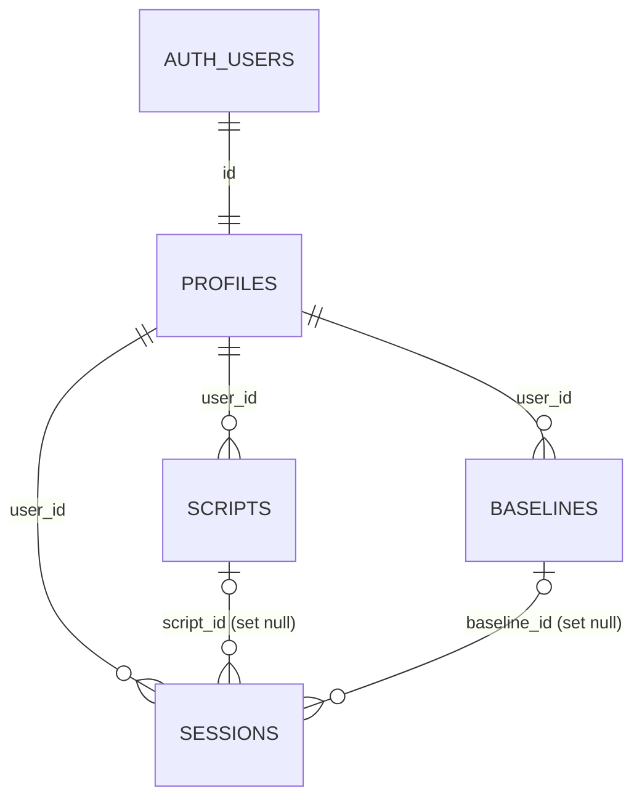
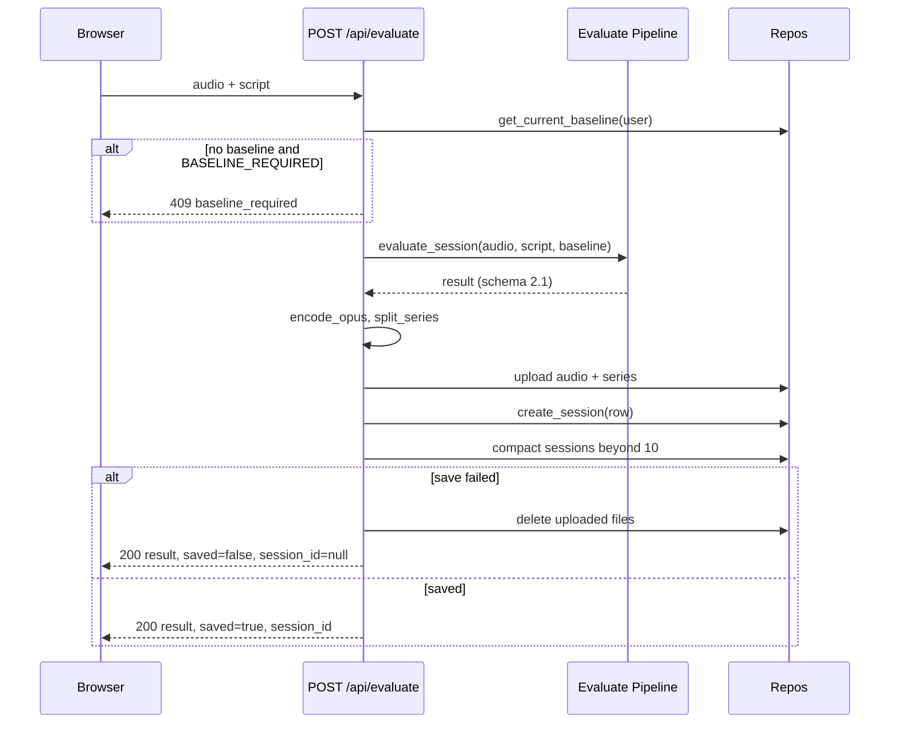

# Architecture

This document describes the **current** structure of Public Speaking Coach: what the parts are, how they talk to each other, and where each piece of code lives. It does not keep a change history; decisions and their reasons live in [`docs/adr/`](docs/adr/).

## Contents

1. [System overview](#1-system-overview)
2. [Code map](#2-code-map)
3. [Backend application](#3-backend-application)
4. [Database and storage](#4-database-and-storage)
5. [Main flows](#5-main-flows)
6. [Security](#6-security)
7. [Configuration](#7-configuration)
8. [Testing](#8-testing)
9. [Decision records](#9-decision-records)

## 1. System overview



| Part                         | Technology                | Responsibility                                |
| ---------------------------- | ------------------------- | --------------------------------------------- |
| Frontend                     | HTML, Tailwind CSS        | UI served by FastAPI from `src/web/`          |
| Backend                      | Python 3.12, FastAPI      | HTTP API, request validation, orchestration   |
| Evaluate / Baseline Pipeline | FFmpeg, Silero VAD, jiwer | Score a recording, analyse a voice baseline   |
| Script Pipeline              | PyMuPDF4LLM, Groq         | Generate an MC script from user content       |
| Database                     | Supabase PostgreSQL       | Profiles, baselines, scripts, session results |
| Object storage               | Supabase Storage          | Audio recordings and chart series             |

## 2. Code map

Only folders with a clear owner and current code are listed.

```
db/migrations/            SQL migrations, applied in file order
src/app/
├── main.py               FastAPI app: /api/evaluate, /api/scripts*, /api/sessions*, static UI
├── routes/               auth.py (/api/auth/*), profile.py (/api/profile), baselines.py (/api/baseline)
├── auth.py               AuthProvider: Supabase Auth, or in-memory accounts in dev
├── deps.py               get_current_user: user from the Bearer access token
├── config.py             Settings loaded from .env
└── db/
    ├── models.py         Pydantic models, errors, object paths, cursor encoding
    ├── repositories.py   Repository interfaces (typing.Protocol)
    ├── supabase_repo.py  Supabase implementation
    ├── memory.py         In-memory implementation for tests and local dev
    ├── factory.py        Repos container and get_repos(): picks the implementation
    └── session_helpers.py Pure helpers: Opus encode, split/merge series, compaction
src/audio_processing/     Evaluate and Baseline Pipeline
src/text_processing/      Script Pipeline
src/web/
├── templates/index.html  Page markup only; loads the CSS files and static/js/main.js
├── static/css/           base, layout, components, screens (loaded in this order)
└── static/js/            ES modules (no bundler): main.js (init), state.js (S, CONFIG, RENDER),
                          i18n.js (TEXT), api.js, ui.js, nav.js, top_bar.js, utils.js, charts.js,
                          data.js, recorder.js, screens/*.js, modals/*.js;
                          evaluate_client.js stays a classic script (also used by node tests)
tests/db/                 Repository and helper tests
```

## 3. Backend application

- Endpoints get the caller with `Depends(get_current_user)` and storage with `Depends(get_repos)`. They never import `supabase` directly.
- Repository and storage calls are synchronous; async endpoints run them through `run_in_threadpool`.
- `user_id` comes only from `get_current_user`, never from the request body or query.

### Endpoints backed by the database

| Method and path                    | Purpose                                                              |
| ---------------------------------- | -------------------------------------------------------------------- |
| `POST /api/baseline`               | Analyse a voice sample; on `ok`, store it as the current baseline    |
| `GET /api/baseline`                | Current baseline, or `null`                                          |
| `POST /api/evaluate`               | Score a recording against the stored baseline, then save the session |
| `GET /api/sessions?limit=&cursor=` | Page of session summaries, newest first, with `next_cursor`          |
| `GET /api/sessions/{id}`           | One session: full result and signed audio URL, or compact summary    |
| `DELETE /api/sessions/{id}`        | Delete the session files, then the row                               |

Error bodies used by these endpoints:

| Status | Body                                                                  | When                                           |
| ------ | --------------------------------------------------------------------- | ---------------------------------------------- |
| 401    | `{"detail": "not_authenticated"}`                                     | No valid current user                          |
| 409    | `{"error_code": "baseline_required", ...}`                            | Evaluate without a baseline                    |
| 503    | `{"error_code": "baseline_not_saved" \| "baseline_unavailable", ...}` | Baseline could not be saved / loaded           |
| 404    | `{"error": "session_not_found"}`                                      | Unknown session or another user's session      |
| 400    | `{"error": "invalid_cursor"}`                                         | Malformed cursor                               |
| 503    | `{"error": "session_storage_unavailable"}`                            | Database or storage error in session endpoints |

## 4. Database and storage

### 4.1 Repository layer

```mermaid
flowchart TB
    Routes["Endpoints"] -->|Depends(get_repos)| Repos["Repos<br/>profiles · baselines · scripts · sessions · files"]
    Repos -.implements.-> Proto["Protocols<br/>repositories.py"]
    Factory["get_repos()"] -->|SUPABASE_URL set| Supa["Supabase*Repo<br/>SupabaseAudioStore"]
    Factory -->|no URL, APP_ENV=dev| Mem["Memory*Repo<br/>MemoryAudioStore"]
    Factory -->|otherwise| Err["StorageError"]
```

- **Interfaces:** `ProfileRepo`, `BaselineRepo`, `ScriptRepo`, `SessionRepo`, `AudioStore`. Every method takes `user_id` first.
- **Two implementations with the same behaviour:** Supabase for real data, in-memory for tests and local runs without a project. Production can never fall back to memory.
- **Shared rules:** a missing row and another user's row look the same (`None` / `False`); lists are newest first by `(created_at, id)`; `limit` is 1..20; library errors become `StorageError` (`ConflictError` for duplicates).
- **Object paths** are built only by `build_object_path` as `{user_id}/{object_id}.webm` or `.series.json`; any other path is rejected.

### 4.2 Data model

Four tables, all with row level security. Full rationale in [ADR-001](docs/adr/ADR-001.md).



| Table       | Holds                     | Notable rules                                                                                |
| ----------- | ------------------------- | -------------------------------------------------------------------------------------------- |
| `profiles`  | One row per user          | `id` = `auth.users.id`; deleting it cascades to all child rows                               |
| `baselines` | Voice baseline measures   | One `is_current` row per user (unique partial index)                                         |
| `scripts`   | Scripts owned by the user | `source`: `generated_template`, `generated_llm`, `written`                                   |
| `sessions`  | Practice results          | Score columns + `result` JSON + `script_snapshot`; `is_compact`, `mistakes` for old sessions |

### 4.3 Object storage

| Bucket      | Content                                       | Path                                 |
| ----------- | --------------------------------------------- | ------------------------------------ |
| `audio`     | Practice recording (Opus/WebM, 32 kbps)       | `{user_id}/{session_id}.webm`        |
| `series`    | Pitch and loudness series split from `result` | `{user_id}/{session_id}.series.json` |
| `baselines` | Baseline recording                            | `{user_id}/{baseline_id}.webm`       |

All buckets are private. The browser plays audio through a signed URL that expires after `SIGNED_URL_TTL_S` seconds.

### 4.4 Retention

After each saved session, full sessions beyond the newest `RETENTION_FULL_SESSIONS` (10) are compacted: their audio and series files are deleted, then the row keeps only a summary `result`, the score columns, `script_snapshot` and `mistakes`. If file deletion fails, the row is left full and the next save retries it.

| Measured size (5-minute recording) | Bytes     | Source                             |
| ---------------------------------- | --------- | ---------------------------------- |
| Full `result` (300 s)              | 1,353,556 | PR 8, `octet_length(result::text)` |
| Compact `result`                   | 1,356     | PR 9                               |
| Compact `mistakes`                 | 74,320    | PR 9                               |
| Whole compact row                  | 742,714   | PR 9                               |

## 5. Main flows

### 5.1 Save a practice session



- A save error never hides the score ([ADR-002](docs/adr/ADR-002.md)). A compaction error does not change `saved`.
- `insufficient_audio` results are saved as a row without audio.

### 5.2 Baseline

1. `POST /api/baseline` analyses the sample. Only an `ok` result is stored.
2. The audio is encoded to Opus and uploaded to `baselines`.
3. `replace_current_baseline` switches the old row off, inserts the new current row, and restores the old row if the insert fails.
4. The old baseline audio is deleted; failure only logs a warning.
5. `POST /api/evaluate` always reads the baseline from the database. A `baseline_profile` sent by the client is ignored.

### 5.3 Open and delete history

- `GET /api/sessions/{id}` merges the series back into `result` and adds `audio_url` for full sessions. `media_available` is `false` for compact sessions or when files cannot be read.
- `DELETE /api/sessions/{id}` deletes files first and the row second, so a failed file delete never leaves orphan files.

## 6. Security

| Layer       | Mechanism                                                                                                                                                                                |
| ----------- | ---------------------------------------------------------------------------------------------------------------------------------------------------------------------------------------- |
| Identity    | `get_current_user` in `src/app/deps.py` verifies the `Authorization: Bearer` access token (Supabase Auth, or in-memory accounts in dev without Supabase); 401 `not_authenticated`. |
| Application | The backend uses the service key, which bypasses RLS, so every query filters by `user_id` in code. Other users' rows return 404.                                                         |
| Database    | RLS on all four tables: owner-only policies (`auth.uid()`). Tables are granted to `authenticated` and `service_role`, not `anon`.                                                        |
| Storage     | Private buckets; policies restrict each user to the folder `{user_id}/`.                                                                                                                 |
| Secrets     | Keys only in `.env` (git-ignored); `.env.example` lists names without values.                                                                                                            |

## 7. Configuration

Settings are read from `.env` by `src/app/config.py`; tunable defaults come from `app_constants.toml`.

API keys: `DEEPGRAM_API_KEYS`, `GLADIA_API_KEYS` and `GROQ_API_KEYS` each hold one or more comma-separated keys (all required). `src/app/key_pool.py` keeps one `KeyPool` per service: on HTTP 429/402 the key is locked for `exhausted_cooldown_s` and the same request is retried with the next key; on 401/403 the key is locked until restart; other errors move on to the next provider or model. STT tries every Deepgram key, then every Gladia key, then returns `503 stt_unavailable`. Groq (`src/text_processing/groq_pool.py`) tries every key for one model before the fallback model (quota is counted per model), then returns `generation_unavailable`. Logs show only the key position (`key #2`).

Database and storage settings:

| Setting                                             | Default                        | Meaning                                         |
| --------------------------------------------------- | ------------------------------ | ----------------------------------------------- |
| `APP_ENV`                                           | `dev`                          | Enables the dev user and in-memory repos        |
| `SUPABASE_URL`, `SUPABASE_SERVICE_KEY`              | empty                          | Use Supabase when the URL is set                |
| `AUDIO_BUCKET`, `SERIES_BUCKET`, `BASELINES_BUCKET` | `audio`, `series`, `baselines` | Bucket names                                    |
| `RETENTION_FULL_SESSIONS`                           | `10`                           | Full sessions kept per user                     |
| `SIGNED_URL_TTL_S`                                  | `600`                          | Signed audio URL lifetime                       |
| `BASELINE_REQUIRED`                                 | `true`                         | Reject evaluation without a baseline            |
| `DEV_USER_ID`                                       | empty                          | First test user, read only by integration tests |

## 8. Testing

- Unit tests use `build_memory_repos()` and `app.dependency_overrides` for `get_repos` and `get_current_user`; they need no network or keys.
- Tests that hit a real Supabase project are marked `integration` and skipped by default: `uv run pytest -m integration` (on `psc-dev` only).

## 9. Decision records

| ADR                            | Title                                                             |
| ------------------------------ | ----------------------------------------------------------------- |
| [ADR-001](docs/adr/ADR-001.md) | Data model for profiles, baselines, scripts and practice sessions |
| [ADR-002](docs/adr/ADR-002.md) | Report save status in the `/api/evaluate` response (schema 2.1)   |

## Accounts and login

| Part | What it does |
| --- | --- |
| `src/app/auth.py` | `AuthProvider` in two versions: `SupabaseAuthProvider` (Supabase Auth with the service key, server side only) and `MemoryAuthProvider` (dev without `SUPABASE_URL`, tests). `get_auth()` picks one, like `get_repos()`. |
| `src/app/routes/auth.py` | `POST /api/auth/signup` creates the account and its `profiles` row (the account is removed again if the profile cannot be saved); `/login`, `/refresh`, `/logout`; `PUT /api/auth/password`. |
| `src/app/routes/profile.py` | `GET` / `PATCH /api/profile` for the Profile Modal and the recording consent. |
| `src/app/deps.py` | `get_current_user` reads and verifies the Bearer token; 503 `auth_unavailable` when Supabase Auth cannot be reached. |
| UI | Keeps the tokens in `localStorage` (F5 keeps the login) and swaps the refresh token for a new session after a 401. |

Saved scripts (`/api/scripts*`) live in the `scripts` table. `/api/evaluate` accepts `script_id` and `topic`, and stores the profile's `target_accent` with the session.
