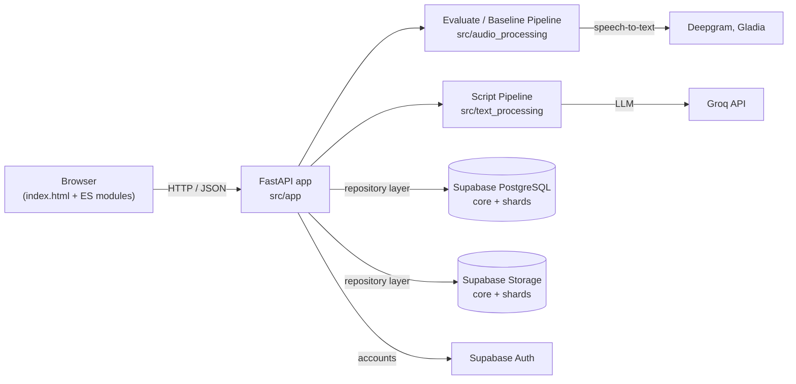
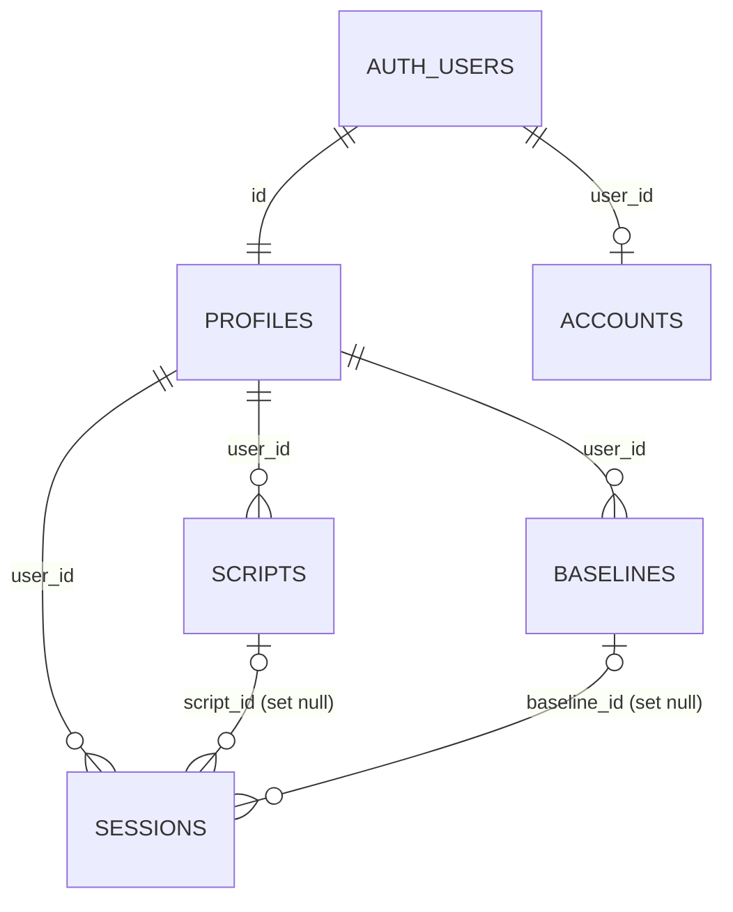
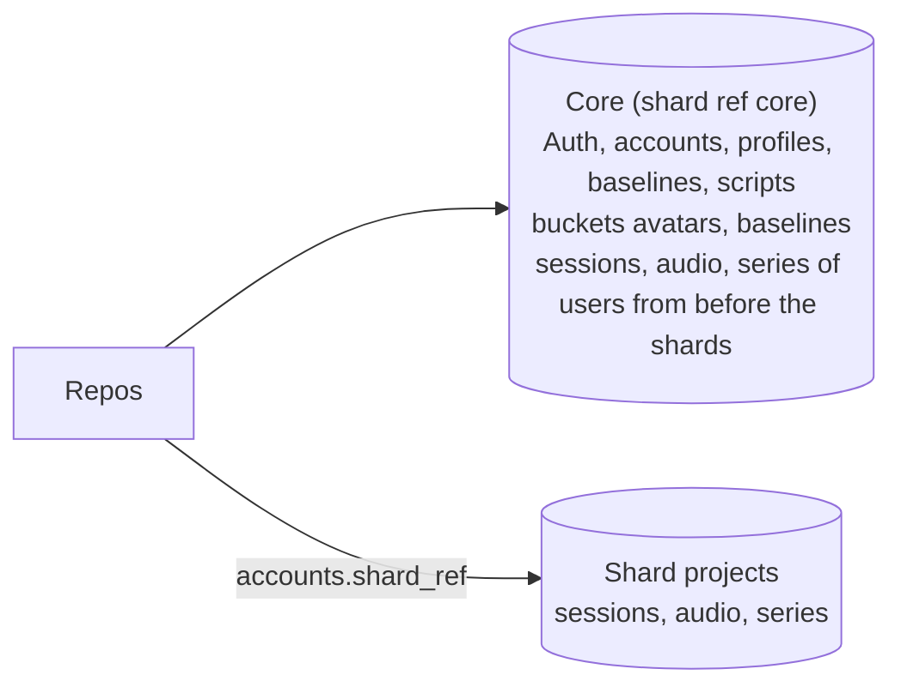
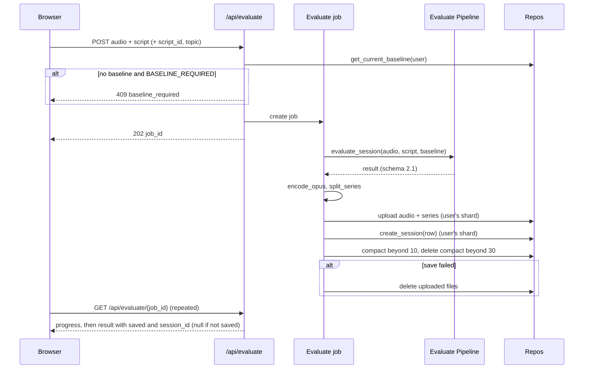

# Architecture

Current structure of Public Speaking Coach: parts, responsibilities, data and the reason for each design choice. Decisions with alternatives are in [`docs/adr/`](docs/adr/).

## Contents

1. [System overview](#1-system-overview)
2. [Code map](#2-code-map)
3. [Backend application](#3-backend-application)
4. [Database and storage](#4-database-and-storage)
5. [Main flows](#5-main-flows)
6. [Browser state](#6-browser-state)
7. [Security](#7-security)
8. [Configuration](#8-configuration)
9. [Testing](#9-testing)
10. [Decision records](#10-decision-records)
11. [Accounts](#11-accounts)

## 1. System overview



| Part                         | Technology                       | Responsibility                                          |
| ---------------------------- | -------------------------------- | ------------------------------------------------------- |
| Frontend                     | HTML, CSS, ES modules (no build) | UI served by FastAPI from `src/web/`                    |
| Backend                      | Python 3.12, FastAPI             | HTTP API, validation, orchestration                     |
| Evaluate / Baseline Pipeline | FFmpeg, Silero VAD, jiwer        | Score a recording, analyse a voice baseline             |
| Script Pipeline              | PyMuPDF4LLM, Groq                | Generate an MC script from user content                 |
| Database                     | Supabase PostgreSQL              | Core: accounts, profiles, preferences, baselines, scripts; user's shard: sessions (see 4.6) |
| Object storage               | Supabase Storage                 | Core: avatars, baselines; user's shard: recordings, chart series |
| Accounts                     | Supabase Auth                    | Sign up, log in, token refresh, password change         |

## 2. Code map

```
db/migration_main/          SQL migrations for the core project, applied in file order (see 4.5)
db/migration_shard/         SQL migrations for every shard project (see 4.5, 4.8)
src/app/
├── main.py                 FastAPI app: /health, /api/config, /api/evaluate*, /api/scripts*,
│                           /api/sessions*, /api/generate-script*, /api/script-chat/*, /api/topics,
│                           static UI (Cache-Control: no-cache)
├── routes/                 auth.py (/api/auth/*), profile.py (/api/profile*), baselines.py (/api/baseline*),
│                           coach.py (/api/sessions/{id}/coach-note), practice.py (/api/practice/retry)
├── auth.py                 AuthProvider: Supabase Auth, or in-memory accounts in dev
├── rate_limit.py           In-memory sliding-window limit for Word Coach retries (account limits: 4.3 `hit_rate_limit`)
├── uploads.py              Safe upload paths and size-capped upload saving
├── deps.py                 get_current_user: user from the Bearer access token
├── config.py               Settings from .env; limits from app_constants.toml; start-up checks
├── constants.py            Loads app_constants.toml
├── key_pool.py             Several API keys per service with automatic switching
└── db/
    ├── models.py           Pydantic models, UserPreferences, errors, object paths, cursor encoding
    ├── repositories.py     Repository interfaces (typing.Protocol)
    ├── supabase_repo.py    Supabase implementation
    ├── memory.py           In-memory implementation (tests, local dev)
    ├── sharding.py         ShardRouter; sessions and audio/series files go to the user's shard
    ├── factory.py          Repos container; get_repos() picks the implementation and wires the shards
    └── session_helpers.py  Opus encoding, series split/merge, compaction
src/audio_processing/       Evaluate and Baseline Pipeline
src/text_processing/        Script Pipeline
src/web/
├── templates/index.html    Markup only; loads CSS and static/js/main.js
├── static/css/             base, layout, components, screens (in this order)
└── static/js/              ES modules, no bundler
    ├── main.js             Start-up, event binding, loadConfig() (GET /api/config -> CONFIG)
    ├── state.js            S (app state), CONFIG (defaults for every [web] key), RENDER
    ├── api.js              fetch wrapper: Bearer token, refresh after 401
    ├── evaluate_client.js  Result mapping and follow-along maths; classic script, also run by node tests
    ├── line_numbers.js     Line numbers beside script text
    ├── mic_device.js       Microphone choice kept per user; classic script, also run by node tests
    ├── otp_utils.js        OTP input helpers; also run by node tests
    ├── script_duplicate.js Duplicate saved-script notices; also run by node tests
    ├── screens/            home, practice, report, history, profile, landing, script_studio,
    │                       saved_scripts, script_reader, coach_mode, word_coach
    └── modals/             auth_panel, baseline_gate, settings_modal, profile_modal, confirm
tests/                      pytest (tests/db: repositories and helpers); tests/web: node tests
```

## 3. Backend application

- Endpoints get the caller with `Depends(get_current_user)` and storage with `Depends(get_repos)`; they never import `supabase` directly. Reason: one place for identity and one swap point between Supabase and memory.
- Repository and storage calls are synchronous; async endpoints run them through `run_in_threadpool`, so network I/O and Pillow work never block the event loop.
- `user_id` comes only from `get_current_user`, never from the request body or query.
- Start-up stops when required settings are missing or `max_list_page_size < max_saved_scripts` (one list call must return every saved script).

### 3.1 Endpoints backed by the database

| Method and path                    | Purpose                                                                      |
| ---------------------------------- | ---------------------------------------------------------------------------- |
| `POST /api/baseline`               | Analyse a voice sample; on `ok`, store it as the current baseline            |
| `GET /api/baseline`                | Current baseline, or `null`                                                  |
| `GET /api/baseline/audio`          | Signed URL of the current baseline recording                                 |
| `POST /api/evaluate`               | Start an evaluate job (202 `job_id`); the job scores the recording against the stored baseline, then saves the session |
| `GET /api/evaluate/{job_id}`       | Job status and progress; the result when done                                |
| `DELETE /api/evaluate/{job_id}`    | Cancel the caller's job                                                      |
| `GET /api/sessions?limit=&cursor=` | Page of session summaries, newest first, with `next_cursor`                  |
| `GET /api/sessions/{id}`           | One session: full result and signed audio URL, or compact summary            |
| `DELETE /api/sessions/{id}`        | Delete the session files, then the row                                       |
| `POST /api/scripts`                | Save a script; duplicate title/body returns 409; cap returns 409             |
| `GET /api/scripts?limit=&cursor=`  | Saved-script summaries with `total`, cap `limit`, `next_cursor`              |
| `GET /api/scripts/{id}`            | One saved script with its body                                               |
| `PATCH /api/scripts/{id}`          | Edit `title` and/or `body`; duplicate title/body returns 409                 |
| `DELETE /api/scripts/{id}`         | Delete a saved script; linked sessions keep `script_snapshot`               |
| `GET /api/profile`                 | Profile row, `email`, `preferences`, signed `avatar_url` or `null`           |
| `PATCH /api/profile`               | Edit profile fields; `preferences` keys are merged, not replaced             |
| `PUT /api/profile/avatar`          | Multipart `file`; checked by content, resized to a square WebP, stored       |
| `DELETE /api/profile/avatar`       | Delete the avatar file, set `avatar_path` to `null`                          |

`GET /api/config` returns the `[web]` section plus limits shared with the backend (`max_saved_scripts`, `script_title_max_chars`, `max_pdf_size_bytes`, `max_pdf_pages`), so each number is declared once.

### 3.2 Profile preferences

`profiles.preferences` (jsonb) holds per-user UI settings. `UserPreferences` (`db/models.py`) rejects unknown keys and checks ranges against `app_constants.toml`.

| Key                                              | Type | Rule                                                   | Used by                          |
| ------------------------------------------------ | ---- | ------------------------------------------------------ | -------------------------------- |
| `follow_wpm`                                     | int  | `follow_wpm_min..follow_wpm_max`, multiple of the step | Practice follow-along speed      |
| `follow_wpm_min_choose`, `follow_wpm_max_choose` | int  | Same range and step; sent together; min < max          | Slider range (Settings)          |
| `follow_auto_speed`                              | bool | Strict boolean                                         | Auto speed on sentence taps      |

Merging uses the SQL function `merge_profile_preferences` (one `update ... set preferences = preferences || patch`), so two saves close together never drop each other's keys.

### 3.3 Error bodies

| Status | Body                                                                     | When                                               |
| ------ | ------------------------------------------------------------------------ | -------------------------------------------------- |
| 401    | `{"detail": "not_authenticated"}`                                        | No valid current user                              |
| 400    | `{"error": "invalid_cursor"}`                                            | Malformed cursor                                   |
| 404    | `{"error": "session_not_found"}`                                         | Unknown session or another user's session          |
| 403    | `{"error_code": "wrong_password", ...}`                                  | Wrong current password (password change, account deletion) |
| 403    | `{"error_code": "consent_required", ...}`                                | Recording route (`/api/evaluate`, `/api/baseline` POST, `/api/practice/retry`) while recording consent is off |
| 422    | `{"error_code": "consent_required", ...}`                                | Sign up, or the sign-up form sent with the code, without recording consent |
| 403    | `{"error_code": "origin_mismatch", ...}`                                 | `/api/auth/refresh` or `/api/auth/logout` from another site's `Origin` |
| 401    | `{"error_code": "invalid_refresh_token", ...}`                           | `/api/auth/refresh` without a valid `psa_refresh` cookie; the cookie is cleared |
| 422    | `{"error_code": "otp_invalid" \| "otp_expired" \| "weak_password", ...}` | Wrong or expired code, or a short new password (sign-up code, password reset) |
| 429    | `{"error_code": "rate_limited", ...}`                                    | Account endpoints: too many codes or tries for one email or user (4.3 `hit_rate_limit`) |
| 409    | `{"error_code": "baseline_required", ...}`                               | Evaluate without a baseline                        |
| 429    | `{"error_code": "rate_limited", ...}`                                    | An evaluate job of the caller is already running   |
| 409    | `{"error_code": "script_limit_reached", "limit": N, "count": N, ...}`    | New saved script at the per-user cap               |
| 409    | `{"error_code": "script_duplicate_body" \| "script_duplicate_title", "duplicate_id", "duplicate_title"}` | Duplicate saved script text or title |
| 413    | `{"error_code": "avatar_too_large", ...}`                                | Avatar above `storage.avatar_max_bytes`            |
| 422    | `{"error_code": "avatar_invalid", ...}`                                  | Not PNG/JPEG/WebP, or a side above `avatar_max_side_px` |
| 422    | Validation error                                                         | Bad `preferences` value                            |
| 503    | `{"error_code": "baseline_not_saved" \| "baseline_unavailable", ...}`   | Baseline could not be saved / loaded               |
| 503    | `{"error": "session_storage_unavailable"}`                               | Database or storage error in session endpoints     |
| 503    | `{"error_code": "script_storage_unavailable", ...}`                      | Database error in saved-script endpoints           |
| 503    | `{"error_code": "profile_unavailable", ...}`                             | Database or storage error in profile endpoints     |
| 503    | `{"error_code": "storage_unavailable", ...}`                             | Account deletion could not delete files or session rows; nothing after that step ran |

## 4. Database and storage

### 4.1 Repository layer

```mermaid
flowchart TB
    Routes["Endpoints"] -->|Depends(get_repos)| Repos["Repos<br/>profiles · baselines · scripts · sessions · files · accounts · rate_limits"]
    Repos -.implements.-> Proto["Protocols<br/>repositories.py"]
    Factory["get_repos()"] -->|SUPABASE_URL set| Supa["Supabase*Repo<br/>SupabaseAudioStore"]
    Factory -->|no URL, APP_ENV=dev| Mem["Memory*Repo<br/>MemoryAudioStore"]
    Factory -->|otherwise| Err["StorageError"]
```

| Rule                                   | Reason                                                                 |
| -------------------------------------- | ---------------------------------------------------------------------- |
| Interfaces `ProfileRepo`, `BaselineRepo`, `ScriptRepo`, `SessionRepo`, `AudioStore`, `AccountRepo`; every method takes `user_id` first | Ownership is part of every call |
| `RateLimitRepo.hit(bucket, key, max_hits, window_s)` takes a hashed key instead of `user_id` | Counts attempts of people who are not logged in (sign-up code, password reset) |
| `sessions` and `files` are sharded wrappers (`sharding.py`); endpoints never pick a project | One place decides where a user's data lives (4.6) |
| Supabase and memory versions behave the same | Unit tests and local runs need no project; production never falls back to memory |
| Missing row and another user's row both return `None` / `False` | No way to probe other users' ids |
| Lists newest first by `(created_at, id)`, cursor based | Stable pages while rows are added |
| List limit `1..storage.max_list_page_size` | Bounded queries; one call returns all saved scripts |
| Library errors become `StorageError` (`ConflictError` for duplicates) | Endpoints map one error type to 503 |
| Object paths only from `build_object_path` (`{user_id}/{id}.webm`, `.series.json`) and `build_avatar_path` (`{user_id}/avatar.webp`) | Every file sits in its owner's folder; other paths are rejected |

### 4.2 Data model

Six tables, all with row level security. Rationale in [ADR-001](docs/adr/ADR-001.md); `accounts` and shards in [ADR-012](docs/adr/ADR-012.md). The diagram shows the core project; in shard projects `sessions` has the same columns without foreign keys.



| Table       | Holds                     | Rules                                                                                     |
| ----------- | ------------------------- | ----------------------------------------------------------------------------------------- |
| `profiles`  | One row per user          | `id` = `auth.users.id`; delete cascades to all child rows; `avatar_path`; `preferences` jsonb |
| `baselines` | Voice baseline measures   | Exactly one row per user, always `is_current`                                             |
| `scripts`   | Saved scripts             | Cap `storage.max_saved_scripts` per user; Only `title`, `body`, `content_hash`; unique `(user_id, lower(title))` and `(user_id, content_hash)` |
| `sessions`  | Practice results          | Score columns, `result` JSON, `script_snapshot`; `is_compact`, `mistakes` for old sessions; lives in the user's shard |
| `accounts`  | Shard of each user        | Core only; `shard_ref` (`core` or a shard's project ref) set the first time the user saves a session or session file; no policy (service key only) |
| `auth_rate_limits` | Attempt counters of the account endpoints | Core only; one row per `(bucket, key)`, key = SHA-256 of the email or user id (never the email); `window_start`, `hits`; rows older than one day deleted every hour by pg_cron; no policy (service key only) |

### 4.3 SQL functions

| Function                    | Migration | Effect                                                                  | Reason                                       |
| --------------------------- | --------- | ----------------------------------------------------------------------- | -------------------------------------------- |
| `merge_profile_preferences` | `0003`    | Merges a jsonb patch into `profiles.preferences`, returns the row       | Atomic per-key merge                         |
| `replace_current_baseline`  | `0008`    | Locks the current baseline, switches it off, inserts the new one, deletes the old rows, returns new and old | One transaction: a failed insert leaves the old baseline current |
| `hit_rate_limit`            | `0011`    | Adds one hit to `(bucket, key)` in a fixed window (a new window starts once `window_s` has passed) and returns whether `hits <= max` | One `insert ... on conflict do update`: parallel requests cannot all slip under the limit |

All are `execute` for `service_role` only (revoked from `public`, `anon`, `authenticated`). The first two take `user_id` as a parameter, because the service key bypasses RLS.

### 4.4 Object storage

| Bucket      | Content                                | Path                                           |
| ----------- | -------------------------------------- | ---------------------------------------------- |
| `audio`     | Practice recording (Opus/WebM, 32 kbps), user's shard | `{user_id}/{session_id}.webm`  |
| `series`    | Pitch and loudness series from `result`, user's shard | `{user_id}/{session_id}.series.json` |
| `baselines` | Baseline recording                     | `{user_id}/{baseline_id}.webm`                 |
| `avatars`   | Profile picture, square WebP           | `{user_id}/avatar.webp` (one file, upsert)     |

All buckets are private. Files reach the browser only as signed URLs valid for `SIGNED_URL_TTL_S` seconds. The fixed avatar path means a new upload replaces the old file and nothing needs cleaning up.

### 4.5 Migrations

Run by hand in the Supabase SQL Editor, in file order. Each file starts with `Run:` (`once`, `any time`, or `required, any time` for the pg_cron jobs), `Where:` (core or shard), `Applied:` (project and date) and `Effect:` lines. The `Run` column below copies that header.

Core project (`db/migration_main/`):

| File                                   | Run                | Creates                                                              |
| -------------------------------------- | ------------------ | -------------------------------------------------------------------- |
| `0001_init.sql`                        | once               | Tables, indexes, RLS policies, grants                                |
| `0002_storage.sql`                     | once               | Buckets `audio`, `series`, `baselines` and folder policies           |
| `0003_profile_avatar_preferences.sql`  | any time           | `profiles.avatar_path`, `profiles.preferences`, bucket `avatars`, `merge_profile_preferences` |
| `0004_replace_baseline_fn.sql`         | any time, never after `0008` | `replace_current_baseline` (replaced by `0008`)            |
| `0005_purge_insufficient_sessions.sql` | required, any time | pg_cron job that deletes `insufficient_audio` sessions after 7 days  |
| `0006_scripts_title_body_only.sql`     | once               | `scripts` keeps title and body only; unique title and body per user  |
| `0007_drop_profile_topics.sql`         | any time           | Drops `profiles.topics` (`drop column if exists`)                    |
| `0008_replace_baseline_delete_old.sql` | any time           | `replace_current_baseline` that keeps one baseline row per user      |
| `0009_purge_unconfirmed_accounts.sql`  | required, any time | pg_cron job that deletes unconfirmed accounts (ADR-011)              |
| `0010_accounts.sql`                    | any time           | `accounts` (user to shard); existing users get `core`                |
| `0011_auth_rate_limits.sql`            | required, any time | `auth_rate_limits`, `hit_rate_limit`, hourly pg_cron cleanup job     |

Shard projects (`db/migration_shard/`):

| File                                                   | Run                | Creates                                                    |
| ------------------------------------------------------ | ------------------ | ---------------------------------------------------------- |
| `migration_shard/0001_sessions.sql`                    | once               | `sessions` without foreign keys, buckets `audio`, `series` |
| `migration_shard/0002_purge_insufficient_sessions.sql` | required, any time | Same pg_cron job as `0005`                                 |

Merged migrations are never edited; a schema change is a new file. The backend is deployed only after its migrations have run.

### 4.6 Core and shard projects



| Rule | Reason |
| ---- | ------ |
| Core is `SUPABASE_URL`; shards come from `SUPABASE_SHARDS`, a JSON object project URL to service key | Easy to add a shard; no numbers to keep in sync |
| `accounts` stores the project ref (`https://<ref>.supabase.co`), never a position | Moving or adding entries in `.env` never points a user at the wrong project; `ShardProject.number` (position + 1) is only a label |
| A user's sessions, audio and series sit in one shard | Saving, compacting and deleting a session touch one project |
| A write gives a user without an `accounts` row the shard project with the fewest users (ties: `.env` order); never the core while a shard exists; a read never does | Users who never practise take no shard space |
| `user_id` is the key in every project | Paths and repo signatures stay the same; old data stays in the core |
| No shards configured: everything is in the core, but `accounts` rows are still written | Turning shards on later keeps old users where their data is |
| Deleting an account: files, then shard session rows, then the auth user | The core cascade does not reach shards; the account goes last so a retry finishes the job |

### 4.7 Retention

| Step | Rule | Reason |
| ---- | ---- | ------ |
| Compact | After each saved session, full sessions beyond the newest `retention_full_sessions` (10) lose audio and series files; the row keeps score columns, a summary `result`, `script_snapshot`, `mistakes` | Free-plan storage; history and progress need only the summary |
| Delete | Compact sessions beyond the newest `max_compact_sessions` (30) are deleted | Bounded rows per user: at most 10 full + 30 compact |
| Retry | If file deletion fails the row stays full; the next save retries | No row points to a missing file |

| Measured size (5-minute recording) | Bytes     |
| ---------------------------------- | --------- |
| Full `result` (300 s)              | 1,353,556 |
| Compact `result`                   | 1,356     |
| Compact `mistakes`                 | 74,320    |
| Whole compact row                  | 742,714   |

### 4.8 Setting up a project

Projects in use: core `psc-main` (`SUPABASE_URL`) and shards `psc-shard01` … `psc-shard09` (`SUPABASE_SHARDS`). Region Singapore, Free plan. **Every project needs the `pg_cron` extension** (Dashboard → Database → Extensions), because each one runs a cleanup job.

**New core project** (only when the core is rebuilt), SQL Editor, in this order:

| Order | File | Run |
| ----- | ---- | --- |
| 1 | `0001_init.sql`, `0002_storage.sql` | once |
| 2 | `0003_profile_avatar_preferences.sql` | any time |
| 3 | `0006_scripts_title_body_only.sql` | once |
| 4 | `0007_drop_profile_topics.sql`, `0008_replace_baseline_delete_old.sql` | any time |
| 5 | `0005_purge_insufficient_sessions.sql`, `0009_purge_unconfirmed_accounts.sql` | required, any time; need `pg_cron` |
| 6 | `0010_accounts.sql` | any time |
| 7 | `0011_auth_rate_limits.sql` | required, any time; needs `pg_cron` |

`0004` is skipped on a new core: `0008` creates the same function in its current form.

**New shard project**, SQL Editor, in this order:

| Order | File | Run |
| ----- | ---- | --- |
| 1 | `migration_shard/0001_sessions.sql` | once |
| 2 | `migration_shard/0002_purge_insufficient_sessions.sql` | required, any time; needs `pg_cron` |

Then add `"https://<ref>.supabase.co": "<service key>"` to `SUPABASE_SHARDS` in `.env` and restart. New users can be placed there at once (never in the core); existing users stay where they are. Never run core migrations on a shard or shard migrations on the core.

After running a migration, update its `Applied:` line (project and date). Check the cleanup jobs with `select jobname, schedule from cron.job;` and that every project answers with `uv run pytest -m integration tests/db/test_shards_live.py`.

## 5. Main flows

### 5.1 Save a practice session



- A save error never hides the score ([ADR-002](docs/adr/ADR-002.md)); a compaction error does not change `saved`.
- `insufficient_audio` results are saved without audio.
- Practice recordings are capped at 1,920 seconds (32 minutes); the 100 MB original-file upload cap is unchanged, and a too-large audio file gets a hint to send MP3 or M4A. STT is sent a 32 kbps Opus copy of the 16 kHz mono master WAV (about 7 MB instead of 62 MB at that duration, both well within the about 1 GB limits of Deepgram and Gladia); if the Opus encoding fails, the WAV is sent.
- Time limits for a 32-minute recording (`app_constants.toml`): `decode_timeout_s = 90` covers the FFmpeg decode (about 5 s on a dev laptop) and each Opus encode (24-29 s); `stt_connect_timeout_s = 30` is also the longest stall while the audio is being sent, and `stt_read_timeout_s = 120` the longest wait for the reply; `max_wait_s = 360` (equal to `EVAL_JOB.maxWaitS` in `state.js`) is how long the client waits for the job. Measured end to end with a 32-minute non-repeating recording and a 4,000-word script: 138 s with Deepgram (VAD 34 s, STT 54 s including the 24 s Opus encode, align 23 s, semantic 20 s), 118 s with Gladia, then 29 s of Opus encoding before saving.
- A practice recording in the browser stops itself at `max_audio_seconds` (`CONFIG.MAX_AUDIO_SECONDS`, sent by `/api/config`) and keeps the take, so a long reading is never refused as `too_long`.
- The Evaluating Overlay shows the job progress. The shown percent counts up one step every `EVAL_COUNT_STEP_MS` (30 ms) toward the real progress, and the progress bars follow the shown number.
- After `evaluate_background_after_ms` (5 s) the job continues in the background: the overlay closes, the user is sent Home with a notice, and the **Eval Dock** (top right, under the header) shows the bar and percent. Clicking it widens the card to the left and lists the steps, with a Cancel button. Practice and every new recording (Practice, Profile baseline, Word Coach) are locked until the job ends (`practiceLocked()`).
- When the job is done, a dialog offers the report; the dock stays at 100% for `EVAL_DOCK_HOLD_MS` (3 s), then slides out to the right and is hidden. A page reload loses the dialog; the saved session still appears in History.

### 5.2 Baseline

1. `POST /api/baseline` analyses the sample; only an `ok` result is stored.
2. The audio is encoded to Opus and uploaded to `baselines`.
3. `replace_current_baseline` (SQL function, RPC) inserts the new row and deletes the old one in one transaction; if it fails, the new audio is deleted and the old baseline stays.
4. The old baseline audio is deleted; a failure only logs a warning. Old sessions keep their result, their `baseline_id` becomes null.
5. `POST /api/evaluate` reads the baseline from the database; a client-sent baseline is ignored.

### 5.3 History

- `GET /api/sessions/{id}` merges the series back into `result` and adds `audio_url` for full sessions. `media_available` is `false` for compact sessions or unreadable files; the Report then hides charts that need the series (for example voice loudness).
- `DELETE /api/sessions/{id}` deletes files first, row second, so a failed file delete never leaves orphan files.

### 5.4 Saved scripts

- A script reaches the `scripts` table only through Save. Practice sends the text without saving; an unsaved script survives only as `sessions.script_snapshot`.
- Duplicate body or case-insensitive title returns `409 script_duplicate_body` or `script_duplicate_title`; a new script at the cap returns `409 script_limit_reached`.
- Deleting a script sets linked `sessions.script_id` to null and keeps `script_snapshot`, so reports still open.

### 5.5 Log in

Two steps. The Busy Overlay ("Logging in…") covers the password check; a wrong password or an unconfirmed email ends there. A correct one cross-fades into the App Loader ("Loading your practice…"), which covers all first data: profile, history with the latest full scores, baseline, saved-script list, web fonts. Home is drawn once after all of them, so nothing on it changes after it appears.

A page load (F5) calls `POST /api/auth/refresh` under the App Loader: the `psa_refresh` cookie gives a new access token and the same first data loads; without a valid cookie the Landing page shows.

## 6. Browser state

| Store            | Key                       | Content                                             | Cleared                                  |
| ---------------- | ------------------------- | --------------------------------------------------- | ---------------------------------------- |
| Memory (`S.auth`) | –                        | Access token only; gone on page close or F5         | Log out, session end                      |
| Cookie (HttpOnly) | `psa_refresh`            | Refresh token; JavaScript cannot read it; sent only to `/api/auth/*`, `SameSite=Strict`, `refresh_cookie_days` | Log out, password reset, account deletion, a refused refresh |
| `localStorage`   | `psa.chat.<user_id>`      | Latest Script Studio chat (data, not HTML), newest `chat_history_max_messages` | Log out, account deletion |
| `localStorage`   | `psc.followWpm.<user_id>` | Follow-along speed not yet saved to the profile     | After a successful save                   |
| `localStorage`   | `psa.mic.<user_id>`       | Chosen microphone `deviceId` (Audio settings)       | Choosing the default device again        |
| Profile (server) | `preferences`             | Speed, slider range, auto speed (see 3.2)           | Account deletion                          |

Per-user keys keep two accounts on one browser apart. Every `localStorage` access is wrapped in `try/catch`, so blocked storage only loses the convenience.

## 7. Security

| Layer       | Mechanism                                                                                                   |
| ----------- | ----------------------------------------------------------------------------------------------------------- |
| Identity    | `get_current_user` verifies the `Authorization: Bearer` token (Supabase Auth, or memory accounts in dev); 401 `not_authenticated`. The access token lives only in page memory; the refresh token only in the `psa_refresh` HttpOnly cookie (6). |
| CSRF        | The refresh cookie is `SameSite=Strict` and scoped to `/api/auth`; `/refresh` and `/logout` also refuse a foreign `Origin` (403 `origin_mismatch`). Other routes need the Bearer header, which another site cannot add. |
| Browser     | HTML responses carry a Content-Security-Policy (own scripts only, styles and fonts from Google Fonts, images and audio from `*.supabase.co`, no framing); every response has `X-Content-Type-Options: nosniff` and `Referrer-Policy: same-origin` (`main.py`). |
| Abuse       | Codes, password resets and re-auth are counted per hashed email or user id in `auth_rate_limits` (4.3); a counter error lets the attempt through and logs a warning, Supabase Auth keeps its own limits. |
| Consent     | Sign up requires recording consent (422); recording routes return 403 `consent_required` while it is off (`deps.require_recording_consent`); past results stay readable. |
| Application | The service key bypasses RLS, so every query and SQL function filters by `user_id` in code. Other users' rows return 404. |
| Database    | Core tables `profiles`, `baselines`, `scripts`, `sessions` have RLS with owner-only policies (`auth.uid()`); `accounts` and every shard project have RLS with no policy (service key only); tables granted to `authenticated` and `service_role`, not `anon`; SQL functions executable by `service_role` only. |
| Storage     | Private buckets; policies limit each user to the folder `{user_id}/`.                                       |
| Uploads     | Avatars checked by content (Pillow), size and pixel limits, re-encoded to WebP; audio size capped before reading. |
| Secrets     | Keys only in `.env` (git-ignored); `.env.example` lists names without values.                                |

## 8. Configuration

`.env` holds secrets and per-environment values, read by `src/app/config.py`. `app_constants.toml` holds every tunable number, one comment each; `.env` wins for the keys marked `(.env)` there. The `[web]` section goes to the browser through `GET /api/config`; `main.js:loadConfig()` copies it into `CONFIG`, and `state.js` holds the fallback for each key.

API keys: `DEEPGRAM_API_KEYS`, `GLADIA_API_KEYS`, `GROQ_API_KEYS`, each one or more comma-separated keys. `key_pool.py` locks a key for `exhausted_cooldown_s` on HTTP 429/402 and until restart on 401/403, then tries the next key or provider. Logs show only the key position.

| Setting                                                              | Default                                   | Meaning                                  |
| -------------------------------------------------------------------- | ----------------------------------------- | ---------------------------------------- |
| `APP_ENV`                                                            | `dev`                                     | `dev` allows in-memory repos and accounts |
| `SUPABASE_URL`, `SUPABASE_SERVICE_KEY`                               | empty                                     | Core project; use Supabase when the URL is set |
| `SUPABASE_SHARDS`                                                    | empty                                     | JSON object shard project URL to service key (4.6); empty: everything in the core |
| `AUDIO_BUCKET`, `SERIES_BUCKET`, `BASELINES_BUCKET`, `AVATARS_BUCKET` | `audio`, `series`, `baselines`, `avatars` | Bucket names                             |
| `RETENTION_FULL_SESSIONS`                                            | `10`                                      | Full sessions kept per user              |
| `MAX_COMPACT_SESSIONS`                                               | `30`                                      | Compact sessions kept per user           |
| `SIGNED_URL_TTL_S`                                                   | `600`                                     | Signed URL lifetime, seconds             |
| `BASELINE_REQUIRED`                                                  | `true`                                    | Reject evaluation without a baseline     |
| `AUTH_COOKIE_SECURE`                                                 | `true`                                    | `Secure` flag of the `psa_refresh` cookie; browsers accept it on `http://localhost` |
| `DEV_USER_ID`, `DEV2_USER_ID`                                        | empty                                     | Test users, read only by integration tests |

Account limits in `app_constants.toml` `[auth]`: `otp_length` (6), `resend_cooldown_s` (60), `verify_attempts_per_window` (5) per `verify_window_s` (600), `unconfirmed_ttl_min` (60), `refresh_cookie_days` (30).

Storage limits in `app_constants.toml` `[storage]`: `max_saved_scripts` (10), `script_title_max_chars` (70), `max_list_page_size` (50), `avatar_max_bytes` (2 MB), `avatar_size_px` (256), `avatar_max_side_px` (4096), `max_upload_bytes` (100 MB).

## 9. Testing

| Command                          | Covers                                                                            |
| -------------------------------- | --------------------------------------------------------------------------------- |
| `uv run pytest`                  | Unit tests with `build_memory_repos()` and dependency overrides; no network or keys |
| `uv run pytest -m integration`   | Real Supabase tests on `psc-main` and the shards (repositories, SQL functions including `hit_rate_limit`, buckets, shard check)          |
| `node --test tests/web/<file>.test.js` | UI helpers run by CI: `evaluate_client`, `otp_utils`, `coach_mode`, `script_duplicate`, `mic_device`, `signup_form`, `reset_form` |
| `uv run ruff check .`            | Lint and import order                                                             |

## 10. Decision records

| ADR                            | Title                                                             |
| ------------------------------ | ----------------------------------------------------------------- |
| [ADR-001](docs/adr/ADR-001.md) | Data model for profiles, baselines, scripts and practice sessions |
| [ADR-002](docs/adr/ADR-002.md) | Report save status in the `/api/evaluate` response (schema 2.1)   |
| [ADR-003](docs/adr/ADR-003.md) | Scoring rubric: formulas, thresholds, flags (formerly `scoring_framework.md`) |
| [ADR-004](docs/adr/ADR-004.md) | `EvaluationResult` v2 JSON contract                               |
| [ADR-005](docs/adr/ADR-005.md) | Phonetic similarity, homophones and near-miss                     |
| [ADR-006](docs/adr/ADR-006.md) | Moderation layer 2 (Llama Guard via Ollama)                       |
| [ADR-007](docs/adr/ADR-007.md) | Async evaluate job with progress                                  |
| [ADR-008](docs/adr/ADR-008.md) | LLM feedback on results (Cerebras, rule-based fallback)           |
| [ADR-009](docs/adr/ADR-009.md) | Retention of `insufficient_audio` sessions                        |
| [ADR-010](docs/adr/ADR-010.md) | Email OTP verification on sign up                                 |
| [ADR-011](docs/adr/ADR-011.md) | Re-auth for password change and account deletion, purge of unconfirmed accounts, microphone choice |
| [ADR-012](docs/adr/ADR-012.md) | Database split into one core and shard projects by user           |
| [ADR-013](docs/adr/ADR-013.md) | Required recording consent, password reset by email code, refresh token in an HttpOnly cookie, rate limits in Postgres |

## 11. Accounts

| Part                        | Role                                                                                                     |
| --------------------------- | -------------------------------------------------------------------------------------------------------- |
| `src/app/auth.py`           | `SupabaseAuthProvider` (service key, server side) and `MemoryAuthProvider` (dev, tests); `get_auth()` picks one like `get_repos()` |
| `src/app/routes/auth.py`    | `POST /api/auth/signup` needs recording consent and creates the account and its `profiles` row (account removed if the profile fails); `/verify-otp`, `/resend-otp` (ADR-010); `/forgot-password`, `/reset-password` send a recovery code and set a new password, ending every session (ADR-013); `/login` and `/refresh` return the access token and set the `psa_refresh` cookie, `/refresh` reads only that cookie, `/logout` clears it (ADR-013); `PUT /api/auth/password` and `DELETE /api/auth/account` re-check the current password (ADR-011); account deletion removes files, then shard session rows, then the auth user (4.6) |
| `src/app/routes/profile.py` | Profile, consent, `preferences`, avatar; a new display name is copied to the account's user metadata for the email greeting |
| `docs/email_templates/`     | Supabase Auth emails (sign-up code, reset code), pasted into the Supabase dashboard; they need a custom SMTP server (README, Email) |
| `src/app/deps.py`           | Verifies the Bearer token; 503 `auth_unavailable` when Supabase Auth is unreachable; `require_recording_consent` guards the recording routes |
