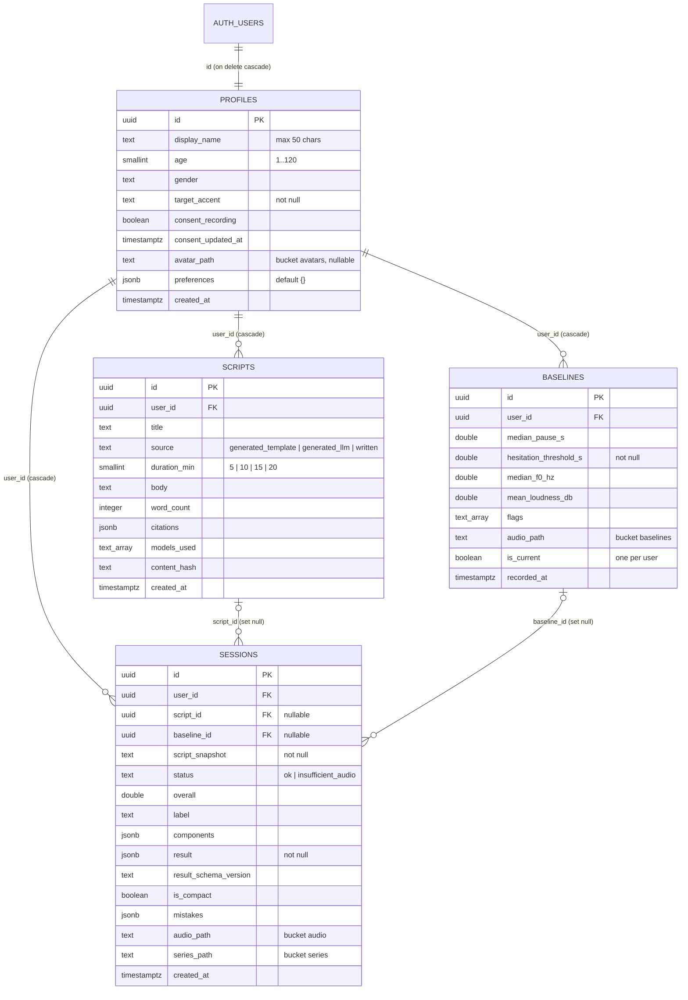

# ADR-001: Data model for profiles, baselines, scripts and practice sessions

- **Status:** Accepted
- **Date:** 2026-11-15
- **Scope:** Database & Storage (`db/migrations/`, `src/app/db/`)

## Context

The app must keep, per user: a profile, a voice baseline, generated scripts, and the history of practice sessions with their scores, audio and chart data. One full evaluation `result` is large: 1,353,556 bytes for a 300-second recording, measured with `octet_length(result::text)` (PR 8). The history list and progress chart only need a few numbers per session.

The stack is PostgreSQL and Storage on Supabase. User identity comes from Supabase Auth (`auth.users`).

## Decision

### Tables

Four tables, all with row level security (RLS). Created by `db/migrations/0001_init.sql`; `profiles.avatar_path` and `profiles.preferences` added by `0003_profile_avatar_preferences.sql`:

Key rules:

1. **`profiles.id` references `auth.users(id)`.** Email lives only in `auth.users`; the app never uses email as a key. Every child table references `profiles(id) on delete cascade`, so deleting a profile deletes its rows.
2. **Score columns are separate from `result`.** `overall`, `label` and `components` are real columns, so the history list and progress chart read them without loading the large `result` JSON.
3. **Chart series go to Storage, not the database.** `pitch_detail.contour_st` and `display_only.loudness_db` are split out of `result` and stored as `{user_id}/{session_id}.series.json` in the `series` bucket. They are merged back only when one full session is opened.
4. **`script_snapshot` copies the script text** used for scoring. An old report stays correct even if the source script is edited or deleted (`script_id` is then set to null).
5. **One baseline row per user.** `replace_current_baseline` deletes the old row after the new one is inserted; the unique partial index `baselines_one_current on (user_id) where is_current` still guards the current row. Each session stores the `baseline_id` it was scored with; it becomes null when that baseline is replaced (`on delete set null`). Baseline audio is kept in the `baselines` bucket.
6. **Keep 10 full sessions, compact older ones, delete beyond 30 compact.** After each save, sessions beyond the newest `retention_full_sessions = 10` full ones are compacted, then compact sessions beyond the newest `max_compact_sessions = 30` are deleted:

   | Data | Newest 10 sessions | Older sessions (compact) |
   | --- | --- | --- |
   | Score columns, `script_snapshot` | Kept | Kept |
   | `mistakes` (misread / missed words, fillers, hesitations, with script position) | Inside `result` | Kept in `mistakes` column |
   | Full `result` | Kept | Replaced by a summary |
   | Audio (`audio` bucket), series (`series` bucket) | Kept | Deleted |

   Measured on a 5-minute recording after compaction (PR 9): `result` 1,356 bytes, `mistakes` 74,320 bytes, whole row 742,714 bytes.
7. **Per-user settings in one jsonb column.** `profiles.preferences` holds UI settings (follow-along speed, slider range, auto speed). Keys are validated by `UserPreferences` in the backend and merged by the SQL function `merge_profile_preferences`, so a new setting needs no migration and concurrent saves keep each other's keys.
8. **Baseline swap in one transaction.** The SQL function `replace_current_baseline` (`0008_replace_baseline_delete_old.sql`) locks and copies the current row, switches it off, inserts the new one and then deletes the old rows, so a failed insert never leaves a user without a baseline. The old row is returned so the backend can delete its audio.
9. **Saved-script cap.** At most `max_saved_scripts` rows per user in `scripts`. Saved scripts keep only `title`, `body`, `content_hash`, and technical fields. Duplicate body or case-insensitive title is rejected. Reports do not depend on `scripts` (rule 4), so deleting a script is a real delete.
10. **Pagination by cursor** `(created_at desc, id desc)`, backed by the index `(user_id, created_at desc, id desc)` on `scripts` and `sessions`. No `offset`, so new rows do not cause duplicates across pages.

### Storage

Four private buckets: `audio`, `series`, `baselines` from `0002_storage.sql`, `avatars` from `0003_profile_avatar_preferences.sql`. Every object path starts with the owner's `user_id`, and a storage policy allows access only to that folder.

| Bucket | Content | Path |
| --- | --- | --- |
| `audio` | Practice recording, Opus in WebM, 32 kbps | `{user_id}/{session_id}.webm` |
| `series` | Pitch and loudness series | `{user_id}/{session_id}.series.json` |
| `baselines` | Baseline recording | `{user_id}/{baseline_id}.webm` |
| `avatars` | Profile picture, square WebP | `{user_id}/avatar.webp` (one per user, upsert) |

### Access control

The backend uses the Supabase service key, which bypasses RLS. Every repository query and SQL function therefore filters by `user_id` (or `id` for `profiles`) itself; the SQL functions are executable by `service_role` only. RLS and the storage policies are a second layer that protects data from clients using the public key. Tables are granted to `authenticated` and `service_role` only, never to `anon`.

## Consequences

- The history list, progress chart and compact sessions never read the full `result`.
- Old sessions lose audio, charts and the full alignment, but keep scores, script and mistakes.
- Files and rows are written in separate steps, so the app must clean up files itself: orphan uploads are deleted when an insert fails, and file deletion is retried on the next retention run.
- Changing the schema means adding a new migration file with a `Run` / `Applied` / `Effect` header; merged migrations are never edited.
- If the Auth team stops using Supabase Auth, the foreign key of `profiles` must move to their account table through a new migration.

## Alternatives considered

- **Store the whole `result` only, no score columns:** every list and chart query would load megabytes of JSON per session.
- **Keep series inside `result`:** makes every row larger, while charts are only needed when one session is opened.
- **Point to the script by `script_id` only:** an edited or deleted script would break old reports.
- **Keep every session in full:** audio and full results grow without limit on the Supabase Free plan.
