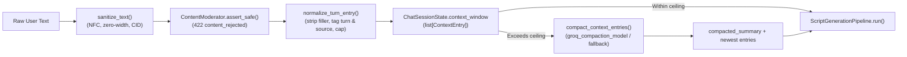

# ADR-014: Pre-generation continuous Groq Q&A, bounded chat context window, compaction, input guards, and step/ETA telemetry

- **Status:** Accepted
- **Date:** 2026-11-25
- **Scope:** `app_constants.toml`, `.env.example`, `src/app/config.py`, `src/app/main.py`, `src/text_processing/parser.py`, `src/text_processing/chat_session.py`, `src/text_processing/pipeline.py`, `src/text_processing/contracts.py`
- **Related:** Issue #120 (`docs/issue_120_pr_plan.md` PR 1, §§1.1–1.6), [ADR-006](ADR-006.md)

## Context

Prior to Issue #120 PR 1, the Script Studio pre-generation gathering flow had five structural gaps:

1. **Unbounded note accumulation:** `ChatSessionState.user_notes` appended raw user turns unboundedly, and `ScriptGenerationPipeline.run()` concatenated every note into slot filling and free-topic prompts, risking Groq free-tier token budget overflows (`8,000 TPM`) on multi-turn chats.
2. **Early hard stop and static free-topic replies:** `check_ready_to_generate` and `build_followup_reply` forced termination at `gather_turns >= 2`, `/api/script-chat/select-topic` could jump straight to `ready_to_generate = True` on Turn 1, free-topic endpoints returned static hardcoded strings without calling Groq, and `main.py` read `pipeline.template_engine.client` (which is `None` by default) instead of resolving `PooledGroqClient`.
3. **Missing backend per-turn limits and unguarded upload reads:** `/api/script-chat/suggest` and `/api/script-chat/message` did not enforce a per-turn text length limit and called `await file.read()` unboundedly before checking file type or per-type byte limits.
4. **No scannable key-request formatting:** Follow-up questions did not wrap requested concepts in `**bold**` markers for frontend highlighting.
5. **Opaque waiting state:** Chat turns returned no processing step progress or buffered ETA, and `GET /api/generate-script/{job_id}` exposed only coarse status and progress integers.

## Decision

### 1. Per-turn input limits and pre-read upload guards

All limits are declared once in `app_constants.toml` under `[script]` (leaving `[web]` unchanged for PR 1 so `test_ui_reads_every_web_key` remains valid) and exported via `src/app/config.py`, `src/text_processing/parser.py`, and `GET /api/config`:

| Setting | Value | Enforcement point |
| --- | --- | --- |
| `max_turn_text_chars` | `18,000` (NFC code points) | `validate_turn_text_length` on `/suggest` and `/message` |
| `composer_max_words` (`[web]`) | `3,000` words | `validate_turn_text_length` on `/suggest` and `/message` |
| `max_pdf_size_bytes` / `max_pdf_pages` | `26,214,400` B (25 MB) / `10` pages | `_read_document_upload_limited` + `validate_pdf_file` |
| `max_text_file_bytes` / `max_text_file_words` | `2,097,152` B (2 MB) / `15,000` words | `_read_document_upload_limited` + `validate_text_file` |

- `POST /api/script-chat/suggest` and `POST /api/script-chat/message` validate turn text length (`422 text_too_long`) and stream-read uploaded `.pdf`, `.md`, and `.txt` files in `64 KB` chunks via `_read_document_upload_limited` (`422 unsupported_file_type` / `file_too_large`) **before** `ContentModerator.assert_safe`, embedding computation, or any Groq API call.

### 2. Raw user text -> bounded context window pipeline

Every Turn 2+ user message (and post-generation `Regenerate` feedback in `ScriptGenerationPipeline.run()`) passes through `append_to_context_window`:

- **Context ceiling policy (`app_constants.toml` `[script]`):**
  - `context_window_max_chars = 4_500` (~1,100–1,200 tokens active budget, leaving headroom within Groq's `8,000 TPM` limit for system prompts, template slots, and output completions)
  - `context_window_max_entries = 8`
  - `context_compaction_keep_recent = 2` (newest 2 processed entries stay intact; if fewer than 3 entries exist when a huge turn crosses the char ceiling, the newest entry is kept intact)
  - `context_compaction_max_summary_chars = 1_500`
- `ScriptGenerationPipeline.run()` reads `sess.compacted_summary` (`[Session Summary]`) plus active `sess.context_window` entries (with legacy fallback when `sess.user_notes` is populated directly by unit tests) for both `TemplateEngine` slot filling/polishing and `ScriptGenerator.generate_free_topic_script`.

### 3. Smaller-model compaction and deterministic fallback

- **Primary compaction model:** `Settings.groq_compaction_model` (`.env`: `GROQ_COMPACTION_MODEL`, `app_constants.toml` default: `"openai/gpt-oss-20b"`), called through `PooledGroqClient` (rotating `GROQ_API_KEYS` on HTTP `429`/`402`/`401`/`403`) and gated by `TokenBucketLimiter` (`max_tokens=300`, `temperature=0.2`, JSON `{"summary": "..."}`).
- **Rate-limit discipline:** Compaction runs **only** when the window ceiling is exceeded (zero extra LLM calls on short sessions). If `TokenBucketLimiter` wait exceeds `5s` or budget cannot be consumed, compaction skips directly to the deterministic fallback without stalling the turn.
- **Deterministic rule-based fallback:** `deterministic_compact_summary()` splits `compacted_summary` and evicted `ContextEntry` items into clauses, deduplicates normalized text, and trims oldest low-signal lines first while preserving numbers, entities, and newest facts within `max_summary_chars`.

### 4. Continuous Groq Q&A loop (Turn 1 vs. Turn 2+)

- The `gather_turns >= 2` forced stop and static free-topic strings are removed across `chat_session.py` and `main.py`.
- `_resolve_groq_client(pipeline)` resolves `template_engine.client`, `llm_generator.client` (when `ScriptGenerator`), or `make_groq_client()`, fixing the bug where production requests passed `client=None` because `TemplateEngine.client` starts as `None`.
- **Turn 1 (`POST /api/script-chat/select-topic`):**
  - Always calls `build_turn1_question` (Groq primary chain with deterministic fallback) for both template-guided and free-topic sessions.
  - Always returns `assistant_turn: 1`, `can_generate: false`, `ready_to_generate: false`, `missing_items`, and a context question with `**bold**` key concepts.
- **Turn 2+ (`POST /api/script-chat/message`):**
  - Sends `(compacted_summary + active context_window + latest answer + missing template slots or free-topic criteria)` in a **single** conservative Groq call (`max_tokens=220`, `temperature=0.4`) returning strict JSON:
    `{"sufficient": bool, "missing_items": [str], "reply_message": str}`.
  - Always returns `assistant_turn >= 2`, `can_generate: true`, `ready_to_generate` (reflecting `sufficient`), `context_compacted`, `compaction_count`, and `missing_items`.
  - When `sufficient` is `false` (or on deterministic fallback), `reply_message` wraps key requested concepts in `**bold**` markers (e.g., `**target audience**`, `**examples**`). The conversation stays open until the user triggers generation.

### 5. Granular processing steps and +10s buffered ETA telemetry

- **ETA buffer:** `eta_buffer_s = 10` (`app_constants.toml` `[script]`) is added to base stage duration estimates so users see realistic buffered waiting times without adding extra LLM calls.
- **Chat turns (`/suggest`, `/select-topic`, `/message` and async `/message/jobs` + `GET /api/script-chat/jobs/{job_id}`):**
  - `TurnStepTracker` tracks ordered step states (`pending` -> `running` -> `done` / `skipped`) across `validating_input`, `moderating`, `matching_templates` / `analyzing_slots` / `updating_context`, `compacting_context` (skipped unless triggered), and `analyzing_with_llm`.
  - Responses include `stage`, `progress`, `steps`, `eta_buffer_s: 10`, `estimated_total_s`, and `estimated_remaining_s` (`0.0` once completed).
- **Script generation (`ScriptJobState` / `GET /api/generate-script/{job_id}`):**
  - Preserves `status` values (`queued`, `extracting`, `moderating`, `generating`, `completed`, `failed`) while adding `stage`, `steps` (`validating_input` -> `extracting` -> `moderating` -> `generating` -> `validating_output`), `eta_buffer_s: 10`, `estimated_total_s`, and `estimated_remaining_s` (`0.0` when `completed` or `failed`).

## Consequences

- Multi-turn pre-generation conversations stay bounded within Groq's free-tier `8,000 TPM` budget and never crash if Groq keys or compaction calls fail.
- Oversized turn texts and oversized `.pdf`/`.md`/`.txt` uploads fail fast with HTTP `422` before allocating full memory buffers or invoking moderation/embeddings/LLM.
- Frontend PR 2 can immediately consume `can_generate`, `assistant_turn`, `ready_to_generate`, `**bold**` spans, `steps`, and `+10s`-buffered ETA fields without further backend schema changes.

## Alternatives considered

- **Separate Groq calls for sufficiency judgement and question generation:** Rejected to stay well inside Groq free-tier RPM (`30`) and TPM (`8,000`) budgets; a single structured JSON call serves both.
- **Putting new limit keys under `app_constants.toml` `[web]` in PR 1:** Rejected because `tests/test_app_constants.py::test_ui_reads_every_web_key` requires every `[web]` key to be referenced in `src/web/static/js/main.js` (PR 2 scope). Placing keys under `[script]` and forwarding them in `GET /api/config` matches `max_pdf_size_bytes` and `max_pdf_pages`.
- **Two-pass LLM summarization on every turn:** Rejected because compacting only when the window ceiling is exceeded yields zero compaction overhead on short conversations.

## Verification

- `uv run ruff check .` passes with zero errors.
- `uv run pytest` passes across `tests/test_chat_session.py`, `tests/test_script_api.py`, `tests/test_script_gen_scenarios.py`, `tests/test_app_constants.py`, and the full repository suite.
